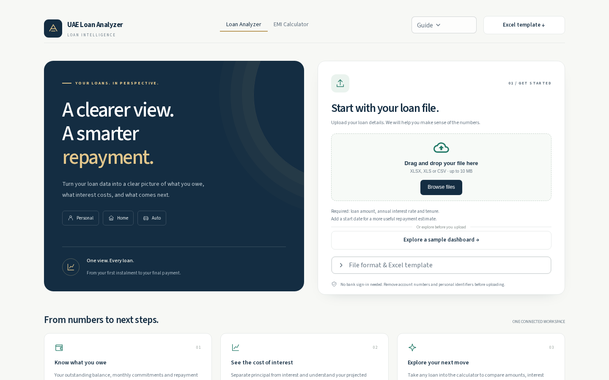
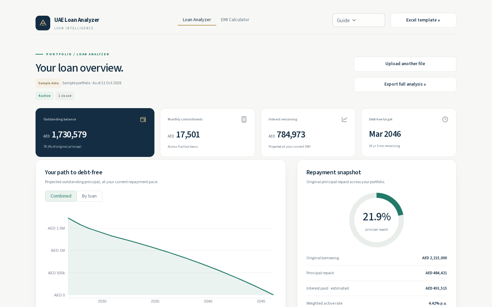
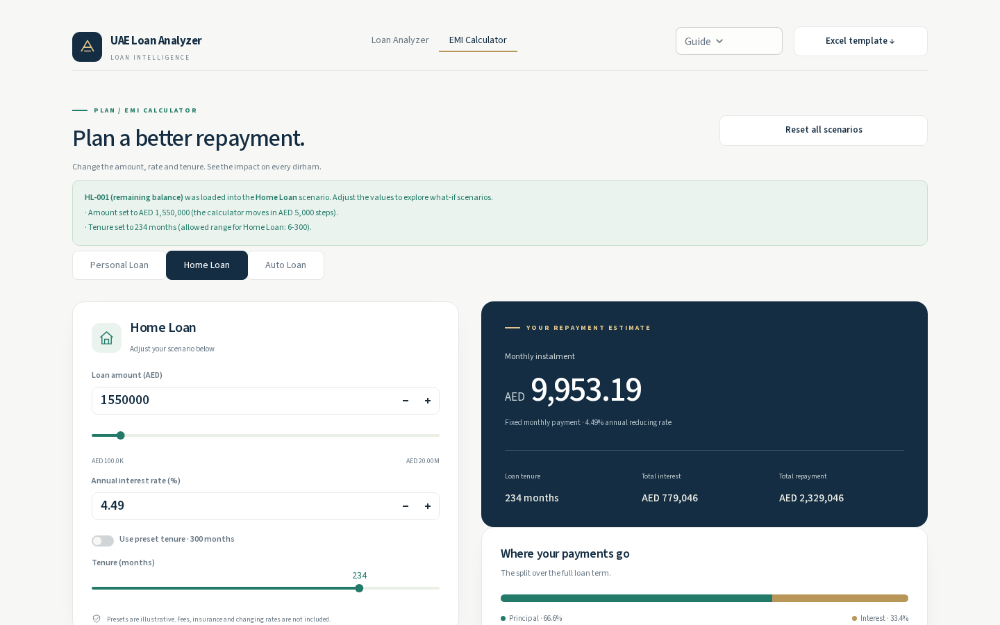
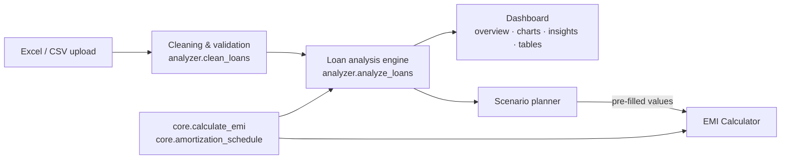

# UAE Loan Analyzer & EMI Calculator

**Upload your loan file and get a clear view of what you owe, how much interest you'll pay, and when you'll be debt-free. Then test what-if scenarios in an EMI calculator that already has your loan filled in.**

A Python / Streamlit data application built by vibe coding for **The Gen Academy – Agentic AI Mastery, Week 1: Data Analysis with Vibe Coding** (Path C: Build your own vibe-coded app).

|                                 |                                                                                                                                                                                             |
| ------------------------------- | ------------------------------------------------------------------------------------------------------------------------------------------------------------------------------------------- |
| **Live demo**             |                                                                                                                                                                                             |
| **Video walkthrough**     |                                                                                                                                                                                             |
| **Project documentation** | [docs.google.com/document/d/1JctEsvySCgxYm59k2fSmk5O3x8Aitg0NdiPRP-6bej8/edit?usp=sharing](https://docs.google.com/document/d/1JctEsvySCgxYm59k2fSmk5O3x8Aitg0NdiPRP-6bej8/edit?usp=sharing) |








---

## Why this project is needed

Almost everyone with a personal, car or home loan in the UAE sees just **one number** each month: the EMI taken from their salary. Bank statements list balances and transactions, but they don't answer the questions borrowers actually have:

- How much of my loan have I **really** repaid, and how much do I still owe?
- How much **interest** have I paid so far, and how much is still to come?
- **When will I be debt-free** if I keep paying as I do now?
- Which loan should I **pay down first**, and what would an extra payment save me?
- Are my EMIs within the **UAE Central Bank's 50% debt-burden guideline**?

Online EMI calculators only answer one question: *what will a **new** loan cost?* None of them start from the loans you **already have**. Most people therefore pay for years without seeing how much of each payment goes to interest, or how small changes could save them thousands of dirhams.

## Who it is for

| User                                                                       | How they use it                                                                                                        |
| -------------------------------------------------------------------------- | ---------------------------------------------------------------------------------------------------------------------- |
| **Salaried residents with one or more loans** (personal, auto, home) | See all loans in one place: outstanding balance, total monthly commitment, interest still to come and a debt-free date |
| **People planning a prepayment or refinance**                        | Send a loan to the calculator and compare a lower rate, a shorter tenure or a smaller balance                          |
| **People applying for new credit**                                   | Check the debt-burden ratio against the 50% guideline before approaching a bank                                        |
| **First-time borrowers**                                             | Compare Personal, Home and Auto loans with UAE preset tenures before signing                                           |
| **Financial advisers and HR / employee-wellbeing teams**             | A simple, private way to walk someone through their loans using an Excel file                                          |

## How it helps

- **Turns a spreadsheet into answers.** Upload one row per loan, and the app works out what's paid, what's left, total interest and the completion date for each loan and for the whole portfolio.
- **Shows where the money goes.** Charts split every year's payments into principal and interest, paid vs projected, so the cost of interest is visible.
- **Gives plain-English insights.** For example: *"Paying AED 999 a month more on HL-001 would save about AED 116,786 in interest and finish 31 months sooner."* Every figure comes from the user's own data.
- **Connects understanding to action.** One click carries a loan's remaining balance, rate and tenure into the EMI Calculator for what-if planning, with no retyping.
- **Private by design.** No bank sign-in. The file is processed in the browser session only and is never stored.

---

## Features

### 1. Loan Analyzer (default home page): *understand your existing loans*

- **Upload** an Excel (`.xlsx`, `.xls`) or `.csv` file, or click **Explore a sample dashboard**.
- **Smart data cleaning:** flexible column names (*Amount*, *Principal*, *Rate*, *Term*…), values like `AED 100,000`, rates as `4.49` or `0.0449`, tenure as `300` or `"25 years"`.
- **Clear validation:** plain-language messages for unreadable files, missing required columns, or skipped rows.
- **Analysis progress screen:** a four-stage progress screen while the analysis runs.
- **Your loan overview:** outstanding balance, monthly commitments, interest remaining and debt-free target.
- **Your path to debt-free:** projected balance over time (Combined / By loan), plus year-end balances.
- **Repayment snapshot:** % of principal repaid, original borrowing, interest paid and weighted rate. An optional monthly income gives a **debt-burden check**.
- **What the numbers are telling you:** data-driven insights (opportunity, interest impact, progress, highest rate, debt-burden).
- **Detail tabs:**
  - **Loan breakdown:** a sortable table.
  - **Repayment analysis:** principal vs interest by year.
  - **Scenario planner:** one-loan schedule with a "Today" marker.
- **Export** the full analysis as CSV.

### 2. EMI Calculator: *explore what-if scenarios*

- Personal, Home and Auto loans with **UAE Central Bank maximum tenures as presets** (48, 300 and 60 months).
- Exact typed amount and rate, plus a slider. Use the preset tenure or set your own.
- **Repayment estimate:** monthly instalment, total interest and total repayment.
- **Where your payments go:** principal vs interest split.
- Tabs:
  - **Repayment journey:** chart with outstanding balance.
  - **Monthly schedule:** full amortization table.
  - **Compare loan types:** side by side.
- **Download** the schedule as CSV.

### 3. Connected journey

Loan Analyzer → **Scenario planner** → *Explore this scenario* → the EMI Calculator opens on the right loan type with the remaining balance (or original terms) already filled in, and a banner explains any rounding.

---

## How it works



All calculations use the standard **reducing-balance EMI formula**:

$$
EMI = P \times r \times \frac{(1+r)^n}{(1+r)^n - 1}
$$

where *P* is the principal, *r* the monthly rate and *n* the number of months.

For each loan the engine:

1. Counts the EMIs already paid from the start date.
2. Estimates the outstanding principal, or uses the statement balance if one is provided, minus any prepayments.
3. Projects the remaining months, remaining interest and payoff date at the current EMI.

---

## Input file format

One row per loan. Only **Loan_Amount**, **Interest_Rate** and **Tenure_Months** are required. A template is available from the app header (**Excel template ↓**) and in `data/sample_loans.xlsx`.

| Field                 | Required    | Type            | Sample Value | Description                               |
| --------------------- | ----------- | --------------- | ------------ | ----------------------------------------- |
| Loan_ID               | Optional    | Text            | HL-001       | Your own reference                        |
| Loan_Type             | Optional    | Text            | Home Loan    | Personal / Home / Auto Loan               |
| Bank                  | Optional    | Text            | Bank A       | Lender name                               |
| Loan_Amount           | Required    | Number (AED)    | 1800000      | Original amount borrowed                  |
| Interest_Rate         | Required    | Number (% p.a.) | 4.49         | `0.0449` also works                     |
| Tenure_Months         | Required    | Number / Text   | 300          | `"25 years"` also works                 |
| Start_Date            | Recommended | Date            | 2021-03-01   | Used to work out EMIs already paid        |
| EMI                   | Optional    | Number (AED)    | 9995         | Calculated if missing                     |
| Outstanding_Principal | Optional    | Number (AED)    | 1550000      | Statement balance; overrides the estimate |
| Prepayment            | Optional    | Number (AED)    | 10000        | Total lump-sum prepaid so far             |

> The sample data uses fictional banks and figures for demonstration.

---

## Tech stack

| Layer                | Tools                                                      |
| -------------------- | ---------------------------------------------------------- |
| Language & packaging | Python 3.12,**uv**, virtual environment, `uv.lock` |
| UI                   | Streamlit, custom design system (CSS), monoline SVG icons  |
| Data                 | pandas, openpyxl                                           |
| Charts               | Plotly                                                     |
| Testing              | pytest                                                     |
| Built with           | AI coding assistant (vibe coding)                          |

## Project structure

```
app.py                                 # app shell: header, navigation, routing, in-page scripts
src/emi_calculator/core.py             # EMI + amortization maths (shared)
src/emi_calculator/analyzer.py         # Loan Analyzer engine: parsing, cleaning, metrics, insights, hand-off
src/emi_calculator/analyzer_page.py    # Loan Analyzer UI (landing, dashboard, tabs, scenario planner)
src/emi_calculator/calculator_page.py  # EMI Calculator UI
src/emi_calculator/styles.py           # design system: tokens, components, responsive rules
.streamlit/config.toml                 # theme
data/sample_loans.xlsx                 # sample input
tests/                                 # pytest unit tests
```

Business logic (`core.py`, `analyzer.py`) is separate from the UI and covered by unit tests, so the interface could be redesigned several times without changing a single calculated number.

---

## Run locally

**Prerequisites:** Python 3.12 and [uv](https://docs.astral.sh/uv/).

```bash
git clone https://github.com/JayanthMalipeddy/uae-loan-analyzer.git
cd uae-loan-analyzer
uv sync                         # creates .venv and installs dependencies
uv run pytest -q                # run the tests
uv run streamlit run app.py     # open http://localhost:8501
```

Then click **Explore a sample dashboard**, or upload `data/sample_loans.xlsx`.

**Windows (PowerShell) tip:** if `uv` isn't installed:

```powershell
powershell -ExecutionPolicy ByPass -c "irm https://astral.sh/uv/install.ps1 | iex"
```

## Deploy (Streamlit Community Cloud)

1. Push the repo to GitHub (public).
2. Go to **share.streamlit.io**, choose **New app**, select this repo, branch `main` and main file `app.py`.
3. Deploy, then add the live link at the top of this README.

---

## How it was built (vibe coding)

The app was built entirely through prompting an AI coding assistant, reviewing the output, running it and iterating:

1. **EMI calculator:** three loan types with UAE preset tenures and an amortization table.
2. **Python + uv packaging:** separate core module and tests.
3. **First UI polish:** banner, background, cards and charts.
4. **Checked against the Week 1 brief:** the AI pointed out the calculator didn't analyse a dataset.
5. **Added the Loan Analyzer:** Excel upload, cleaning, analysis engine, insights, and the hand-off to the calculator.
6. **Premium banking redesign:** upload states, a progress screen and a design system.
7. **Made both modules consistent:** equal panels and a single insight layout.
8. **Bug fixes found by testing in the browser:** stale pre-fills, chart axis labels, layout spacing.
9. **Adopted an approved design preview:** a single design system across both modules.

Full prompts, iterations and a bug log are in the project documentation.

## Roadmap

- AI Loan Advisor: a tool-calling agent that answers "what if" questions using the tested calculation functions.
- Filters by loan type, lender and status.
- Bank-statement PDF import, and Arabic language support.

## Disclaimer

Figures are estimates based on standard reducing-balance calculations and the data provided. Fees, insurance, rate changes, payment holidays and missed instalments are not included. **This is not a bank offer or financial advice**; your lender's statement remains the final reference.

## Author

**Jayanth Kumar** ([@JayanthMalipeddy](https://github.com/JayanthMalipeddy)), Dubai
Built for The Gen Academy – Agentic AI Mastery cohort, Week 1.
